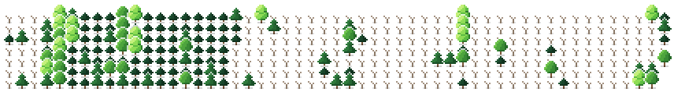

## Hi, I'm Ethan 👋

I'm a third-year CS student @ UofT specializing in Software Engineering. I build full-stack and distributed systems, and I also work on computer vision and AI tools.

**Currently:** MLE @ Pada Guidance 
**Incoming:** SRE @ PointClickCare

### Projects

- **[CO₂LAB](https://github.com/turtle-geek/co2lab)**: *Winner @ Hack The Valley*, turns old devices into a fleet of AI agents.
- **Stock Screener**: *2nd @ UofT Trading Competition*, flags trade catalysts from real-time market data.
- **[UmapCare](https://github.com/turtle-geek/UmapCare)**: *Top 5 @ DataFest*, maps patient journeys to reduce travel friction in Kansas diabetes care.
- **[SherLock](https://github.com/turtle-geek/SherLock)**: Real-time defense against financial social engineering.
- **[Loomis-Lens](https://github.com/turtle-geek/Loomis-Lens)**: Head-pose estimation for drawing faces in perspective.

<picture>
  <source media="(prefers-color-scheme: dark)" srcset="assets/forest-dark.svg">
  
</picture>
